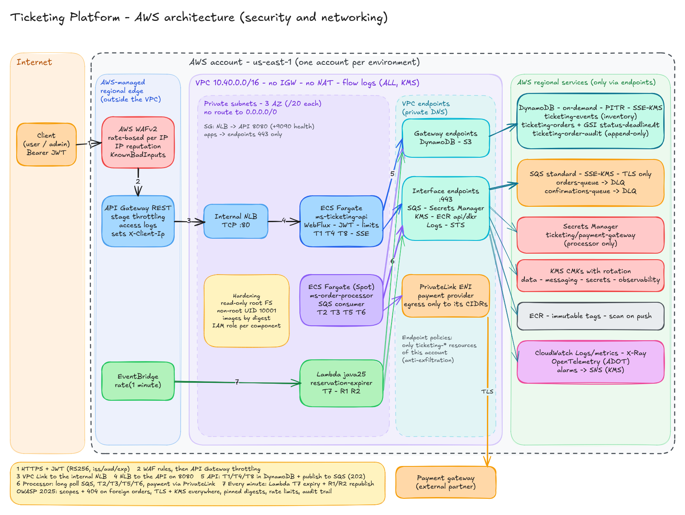
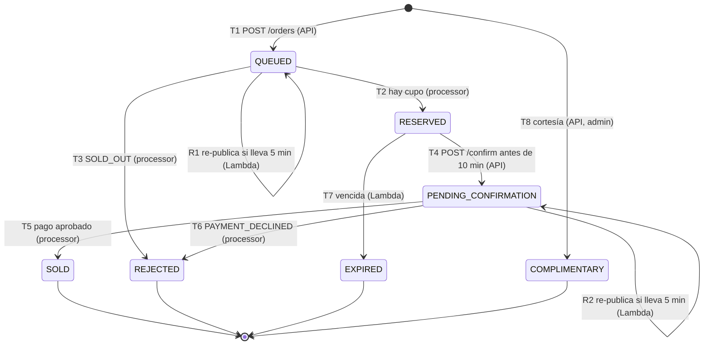

# Ticketing Platform

Plataforma reactiva y basada en eventos para la venta de entradas: encola las compras, las procesa de forma
asíncrona y **garantiza que nunca se venden más entradas de las disponibles**, incluso con miles de
compradores concurrentes.

Java 25 · Spring Boot 4.1 (WebFlux) · Project Reactor · DynamoDB · SQS · AWS Lambda · OpenTelemetry ·
LocalStack · Terraform. Los tres componentes se generaron con el
[scaffold de Clean Architecture de Bancolombia](https://bancolombia.github.io/scaffold-clean-architecture/) (5.0.1).

La infraestructura como código vive en un repositorio aparte:
[ticketing-infra](https://github.com/DaniBonica001/ticketing-infra).

## Contenido

1. [Arquitectura](#1-arquitectura)
2. [Cómo cumple cada requisito](#2-cómo-cumple-cada-requisito)
3. [Instalación y ejecución](#3-instalación-y-ejecución)
4. [Endpoints y ejemplos](#4-endpoints-y-ejemplos)
5. [Tests y cobertura](#5-tests-y-cobertura)
6. [Decisiones de arquitectura](#6-decisiones-de-arquitectura)
7. [Estructura del repositorio](#7-estructura-del-repositorio)
8. [Limitaciones de la solución](#8-limitaciones-de-la-solución)
9. [Posibles mejoras](#9-posibles-mejoras)
10. [Qué decisiones cambiaría en un entorno productivo real](#10-qué-decisiones-cambiaría-en-un-entorno-productivo-real)

## 1. Arquitectura



Fuente editable: [`docs/diagrams/architecture.excalidraw`](docs/diagrams/architecture.excalidraw)
(se abre en [excalidraw.com](https://excalidraw.com) con *Open*).

Tres componentes desacoplados por colas:

| Componente | Runtime | Responsabilidad | Transiciones |
|---|---|---|---|
| `ms-ticketing-api` | Spring Boot WebFlux (ECS Fargate) | API REST, JWT, idempotencia, rate limit, disponibilidad en tiempo real (SSE) | T1, T4, T8 y edición de eventos |
| `ms-order-processor` | Spring Boot, consumidor SQS (ECS Fargate) | Reserva el inventario y procesa el resultado del pago | T2, T3, T5, T6 |
| `ms-reservation-expirer` | AWS Lambda `java25`, sin Spring, disparada por EventBridge cada minuto | Libera reservas vencidas y reconcilia órdenes atascadas | T7, R1, R2 |

La API **nunca toca el inventario al crear una orden**: guarda la orden como `QUEUED`, publica un mensaje y
responde `202` en milisegundos. Por eso aguanta los picos. El processor aplica cada cambio de estado con una
**transacción condicional de DynamoDB**, que es lo que hace imposible la sobreventa.

### Ciclo de vida de una orden



El inventario de cada evento cumple siempre
`available + reserved + pendingConfirmation + sold + complimentary = capacity`.

Documentación detallada:

| Documento | Contenido |
|---|---|
| [Modelo de dominio](docs/design/domain-model.md) | Estados, transiciones T1–T8 / R1–R2 e invariantes |
| [Diseño de DynamoDB](docs/design/dynamodb.md) | Tablas, GSI y las transacciones exactas |
| [Errores y reintentos](docs/design/error-handling-and-retries.md) | Matriz de reintentos, controles de abuso y catálogo de errores |
| [Diagramas de secuencia](docs/diagrams/sequence-diagrams.md) | 8 flujos en Mermaid |
| [Convenciones](docs/design/conventions.md) | Nombres de recursos, puertos, variables de entorno y versiones |
| [ADRs](docs/README.md) | 8 decisiones de arquitectura con alternativas descartadas |
| [OpenAPI 3.1](contracts/openapi/ticketing-api.yaml) | Contrato REST |
| [Mensajes SQS](contracts/messages/order-message.schema.json) | JSON Schema de los mensajes |

## 2. Cómo cumple cada requisito

| Requisito | Cómo se cumple | Dónde verlo |
|---|---|---|
| Gestión de eventos con inventario | CRUD de eventos con contadores por estado; edición con optimistic locking (`If-Match`) | `POST/GET/PUT /events` |
| Reserva temporal de 10 min | `RESERVED` con `deadlineAt = now + 600`; `confirm` exige `deadlineAt > now` | T2, T4 |
| Compra asíncrona | `202` + `orderId` inmediato; el processor valida el inventario | T1 → SQS → T2 |
| Consultar el estado de una orden | `GET /orders/{id}` y auditoría completa en `/history` | `ticketing-order-audit` |
| Sin sobreventa ante concurrencia | `UPDATE ... CONDITION available >= :q` dentro de `TransactWriteItems`, sin locks | ADR-0002, `make load-test` |
| Liberación automática periódica | Lambda + EventBridge `rate(1 minute)` sobre un GSI disperso | ADR-0005 |
| Disponibilidad en tiempo real | `GET /availability` con lectura fuertemente consistente y stream SSE | `/availability/stream` |
| Java 25, Spring Boot 4, WebFlux | Scaffold de Bancolombia 5.0.1 → Spring Boot 4.1.1, Reactor 3.8 | `build.gradle` de cada micro |
| Persistencia NoSQL | DynamoDB on-demand, 3 tablas, GSI `status-deadlineAt-index` | `docs/design/dynamodb.md` |
| Cola de mensajes, at-least-once | SQS estándar + DLQ y consumidores idempotentes | ADR-0003 |
| Retry reactivo | `Retry.backoff` solo para errores transitorios; circuit breaker para la pasarela | §6.4 |
| Optimistic locking o conditional writes | Ambos, cada uno donde corresponde | §6.1 |
| Clean Architecture | Scaffold: `domain/model`, `domain/usecase`, `infrastructure/*`, `applications/app-service`; validado con ArchUnit | §7 |
| Docker / docker-compose | Stack completo con `make up`; imágenes multi-stage, el evaluador no necesita Java | §3 |
| Tests ≥ 90 % (incluida concurrencia) | Gate de JaCoCo al 90 % que hace fallar el build; tests de carrera con LocalStack | §5 |
| Colección de requests | Postman (Newman) + curl + script de demo con aserciones | §4 |

## 3. Instalación y ejecución

### Prerrequisitos

| Herramienta | Versión | Para qué |
|---|---|---|
| Docker + Docker Compose v2 | Docker Desktop 4.x o Engine 24+ | Todo el stack (no hace falta Java instalado) |
| GNU Make, bash, curl, openssl | cualquiera reciente | Atajos, llaves JWT locales y ejemplos |
| Python 3 | ≥ 3.9 | `make demo` y `make load-test` (solo librería estándar) |
| `uuidgen` | macOS o util-linux | Idempotency keys en `make demo` |
| Node.js (opcional) | ≥ 18 | `make postman` (Newman vía `npx`) |
| Java 25 (opcional) | Temurin 25 | Solo para correr los tests fuera de Docker |

Recursos recomendados para Docker: 4 CPU y 6 GB de RAM. El primer `make up` descarga imágenes y compila los
tres micros dentro de Docker, así que tarda unos minutos.

### Arranque rápido

```bash
git clone https://github.com/DaniBonica001/ticketing-platform.git
cd ticketing-platform

make up       # genera las llaves JWT locales, construye y levanta todo el stack
make smoke    # health checks + recursos AWS creados en LocalStack
make demo     # recorre los flujos principales y verifica cada paso (21 aserciones)
```

| Servicio | URL | Notas |
|---|---|---|
| API | http://127.0.0.1:8090/api/v1 | Única entrada al stack |
| Grafana | http://127.0.0.1:3300 | Dashboard *Ticketing* (trazas, métricas y logs) |
| LocalStack | http://127.0.0.1:4766 | Solo para depurar (`aws --endpoint-url ...`) |

Todos los puertos se publican solo en `127.0.0.1` y se eligieron para no chocar con otros stacks locales
que usan 4566–4599. No hace falta un archivo `.env`: cada variable tiene un valor por defecto que funciona.
Para cambiar algo, copia [`.env.example`](.env.example) a `.env` (está en `.gitignore`).

### Qué levanta `docker compose`

| Servicio | Imagen | Función |
|---|---|---|
| `localstack` | `localstack/localstack:4.14.0` (fijada por digest) | DynamoDB, SQS, Lambda, EventBridge, Secrets Manager, KMS, IAM |
| `expirer-builder` | Temurin 25 | Compila el zip de la Lambda dentro de Docker |
| `aws-bootstrap` | AWS CLI | Crea tablas, GSI, colas + DLQ, llaves KMS, secreto, Lambda y regla de EventBridge (idempotente) |
| `otel-lgtm` | `grafana/otel-lgtm:0.36.0` | Collector OTLP + Tempo + Prometheus + Loki + Grafana |
| `ms-ticketing-api` | build local | API en el puerto 8080 del contenedor |
| `ms-order-processor` | build local | Consumidor de las dos colas |

La Lambda la ejecuta LocalStack en su propio contenedor (`ticketing-localstack-lambda-*`).

Redes: `ticketing-internal` es `internal: true` (sin salida a internet) y une apps, LocalStack, OTel y
la Lambda; `ticketing-edge` solo expone la API. Los contenedores corren con root FS de solo lectura,
`cap_drop: ALL`, `no-new-privileges`, usuario no root y límites de CPU, memoria y pids.

### Comandos

| Comando | Qué hace |
|---|---|
| `make up` | Construye y levanta el stack |
| `make down` | Detiene el stack y borra volúmenes y contenedores de Lambda |
| `make ps` / `make logs [SERVICE=ms-order-processor]` | Estado y logs |
| `make token-user` / `make token-admin` | Imprime un JWT de 15 min (`ticketing:user` / `ticketing:admin`) |
| `make smoke` | Health checks y listado de recursos AWS |
| `make demo` | Flujos de punta a punta con aserciones |
| `make load-test` | Ráfaga concurrente de compras: demuestra que no hay sobreventa |
| `make postman` | Ejecuta la colección de Postman con Newman |
| `make bootstrap` | Vuelve a correr el bootstrap de AWS (idempotente) |
| `make config` | Valida `docker-compose.yml` |

Equivalentes sin Make:

```bash
scripts/generate-dev-keys.sh                     # llaves JWT del IdP simulado (local/secrets/, git-ignored)
docker compose up -d --build                      # levantar
docker compose ps                                 # estado
docker compose logs -f ms-ticketing-api           # logs
docker compose down -v --remove-orphans           # bajar y borrar volúmenes
docker ps -aq --filter 'name=^ticketing-localstack-lambda-' | xargs -r docker rm -f
```

## 4. Endpoints y ejemplos

| Método | Ruta | Scope | Descripción |
|---|---|---|---|
| `GET` | `/api/v1/events?limit=&cursor=` | público | Lista eventos (paginado) |
| `POST` | `/api/v1/events` | admin | Crea un evento |
| `GET` / `HEAD` | `/api/v1/events/{id}` | público | Detalle, con `ETag` = versión |
| `PUT` | `/api/v1/events/{id}` | admin | Edita nombre/fecha/lugar; exige `If-Match` |
| `GET` | `/api/v1/events/{id}/availability` | público | Disponibilidad (lectura consistente) |
| `GET` | `/api/v1/events/{id}/availability/stream` | público | Disponibilidad en tiempo real (SSE) |
| `POST` | `/api/v1/events/{id}/complimentary` | admin | Entrega cortesías; exige `Idempotency-Key` |
| `POST` | `/api/v1/orders` | user | Inicia una compra; exige `Idempotency-Key` |
| `GET` | `/api/v1/orders/{id}` | dueño o admin | Estado de la orden |
| `POST` | `/api/v1/orders/{id}/confirm` | dueño | Confirma el pago de una reserva |
| `GET` | `/api/v1/orders/{id}/history` | dueño o admin | Auditoría de transiciones |

Los errores siguen RFC 9457 (Problem Details) e incluyen `code` y `traceId`. Una orden de otro usuario
responde `404`, no `403`, para no revelar que existe.

### Recorrido con curl

Las respuestas son reales, capturadas contra el stack local.

```bash
API=http://127.0.0.1:8090/api/v1
ADMIN=$(make -s token-admin)
ANA=$(make -s token-user TOKEN_SUB_USER=ana)
```

**1. Crear un evento (admin)**

```bash
curl -s -X POST $API/events -H "Authorization: Bearer $ADMIN" -H 'Content-Type: application/json' \
  -d '{"name":"Karol G - Tropicoqueta Tour","eventDate":"2026-12-20T20:00:00-05:00","venue":"Estadio Atanasio Girardot","capacity":5}'
```
```json
{"eventId":"dd4df983-9636-46e5-a4bc-e1840b7a8a5d","name":"Karol G - Tropicoqueta Tour",
 "eventDate":"2026-12-20T20:00:00-05:00","venue":"Estadio Atanasio Girardot","capacity":5,
 "availability":{"capacity":5,"available":5,"reserved":0,"pendingConfirmation":0,"sold":0,"complimentary":0, "...":"..."},
 "version":1,"createdAt":"2026-10-18T22:11:40.883Z","updatedAt":"2026-10-18T22:11:40.883Z"}
```

**2. Comprar 2 entradas (respuesta inmediata, procesamiento asíncrono)**

```bash
EVENT_ID=dd4df983-9636-46e5-a4bc-e1840b7a8a5d
curl -s -i -X POST $API/orders -H "Authorization: Bearer $ANA" \
  -H "Idempotency-Key: 7c1e4f0a-3b2d-4e5f-8a9b-0c1d2e3f4a5b" -H 'Content-Type: application/json' \
  -d "{\"eventId\":\"$EVENT_ID\",\"quantity\":2}"
```
```http
HTTP/1.1 202 Accepted
Location: /api/v1/orders/62306555-aa86-59ea-9ba0-1329760d4cae

{"orderId":"62306555-aa86-59ea-9ba0-1329760d4cae","eventId":"dd4df983-…","quantity":2,"status":"QUEUED",
 "reason":null,"expiresAt":null,"createdAt":"2026-10-18T22:11:40.960Z","updatedAt":"2026-10-18T22:11:40.960Z"}
```

Repetir la petición con la misma `Idempotency-Key` devuelve la misma orden. Reusar la key con otro payload:

```json
{"type":"https://ticketing.local/problems/idempotency-key-reused","title":"Idempotency key reused","status":422,
 "code":"IDEMPOTENCY_KEY_REUSED","detail":"The Idempotency-Key was already used with a different payload",
 "instance":"/api/v1/orders","traceId":"7bd614fa7ed7be133bca3347b0647222"}
```

**3. Consultar la orden (el processor ya la reservó por 10 minutos)**

```bash
ORDER_ID=62306555-aa86-59ea-9ba0-1329760d4cae
curl -s $API/orders/$ORDER_ID -H "Authorization: Bearer $ANA"
```
```json
{"orderId":"62306555-…","quantity":2,"status":"RESERVED","reason":null,"expiresAt":"2026-10-18T22:21:41.000Z", "...":"..."}
```

**4. Disponibilidad**

```bash
curl -s $API/events/$EVENT_ID/availability
curl -N $API/events/$EVENT_ID/availability/stream     # SSE: un evento por cada cambio
```
```json
{"eventId":"dd4df983-…","capacity":5,"available":3,"reserved":2,"pendingConfirmation":0,"sold":0,"complimentary":0,
 "asOf":"2026-10-18T22:11:44.099Z"}
```

**5. Confirmar el pago**

```bash
curl -s -X POST $API/orders/$ORDER_ID/confirm -H "Authorization: Bearer $ANA" \
  -H 'Content-Type: application/json' -d '{"paymentReference":"PAY-123"}'
```
```json
{"orderId":"62306555-…","status":"PENDING_CONFIRMATION", "...":"..."}
```

Una `paymentReference` que empieza por `DECLINED-` simula un pago rechazado: la orden queda
`REJECTED(PAYMENT_DECLINED)` y las entradas vuelven a `available`. Confirmar dos veces no cobra dos veces:

```json
{"status":409,"code":"INVALID_ORDER_STATE",
 "detail":"Order 62306555-… cannot move from SOLD to PENDING_CONFIRMATION", "...":"..."}
```

**6. Auditoría**

```bash
curl -s $API/orders/$ORDER_ID/history -H "Authorization: Bearer $ANA"
```
```json
[{"fromStatus":null,"toStatus":"QUEUED","actor":"ticketing-api","occurredAt":"2026-10-18T22:11:40.960Z"},
 {"fromStatus":"QUEUED","toStatus":"RESERVED","actor":"order-processor","occurredAt":"2026-10-18T22:11:41.011Z"},
 {"fromStatus":"RESERVED","toStatus":"PENDING_CONFIRMATION","actor":"ticketing-api","occurredAt":"2026-10-18T22:11:44.119Z"},
 {"fromStatus":"PENDING_CONFIRMATION","toStatus":"SOLD","actor":"order-processor","occurredAt":"2026-10-18T22:11:44.146Z"}]
```

**7. Editar un evento con optimistic locking**

```bash
ETAG=$(curl -sI $API/events/$EVENT_ID | awk -F': ' 'tolower($1)=="etag"{print $2}' | tr -d '\r')
curl -s -X PUT $API/events/$EVENT_ID -H "Authorization: Bearer $ADMIN" -H "If-Match: $ETAG" \
  -H 'Content-Type: application/json' \
  -d '{"name":"Karol G (nueva fecha)","eventDate":"2026-12-21T20:00:00-05:00","venue":"Estadio Atanasio Girardot"}'
```

Sin `If-Match` responde `428`. Con una versión vieja responde `412 VERSION_CONFLICT`.

**8. Cortesía (admin)**

```bash
curl -s -X POST $API/events/$EVENT_ID/complimentary -H "Authorization: Bearer $ADMIN" \
  -H "Idempotency-Key: $(uuidgen)" -H 'Content-Type: application/json' \
  -d '{"quantity":1,"recipientUserId":"vip-1"}'
```

### Postman

- Colección: [`postman/ticketing-api.postman_collection.json`](postman/ticketing-api.postman_collection.json).
- Entorno: [`postman/local.postman_environment.json`](postman/local.postman_environment.json).

Para usarla, importa ambos archivos y pega en `userToken` y `adminToken` la salida de `make token-user` y
`make token-admin`. Para correrla por consola: `make postman` (25 aserciones). El stream SSE no está en la
colección porque bloquea a Newman; se prueba con `curl -N`.

### Demo y prueba de carga

- `make demo`: Ana compra y paga, Beto reserva, Carla recibe `SOLD_OUT`, los reintentos son idempotentes,
  un pago se rechaza, un admin da una cortesía y se ejercita el optimistic locking. Beto no confirma, así que
  en ~11 minutos la Lambda expira su reserva y devuelve las entradas.
- `make load-test`: 500 compradores concurrentes piden 739 entradas de un evento con 50 cupos. Resultado
  verificado: **exactamente 50 reservadas**, el resto `REJECTED(SOLD_OUT)`, y la suma de contadores sigue
  siendo igual a la capacidad.

## 5. Tests y cobertura

Cada micro es un proyecto Gradle independiente. `./gradlew build` corre los tests y **falla si la cobertura
de líneas es menor al 90 %** (tareas `jacocoCoverageGate` y `jacocoCoverageReport`).

```bash
cd ms-ticketing-api && ./gradlew build        # requiere Java 25 y Docker (tests con LocalStack)
open build/reports/jacocoCoverage/html/index.html
```

| Micro | Tests | Cobertura de líneas |
|---|---|---|
| `ms-ticketing-api` | 251 | ~99 % |
| `ms-order-processor` | 158 | 100 % |
| `ms-reservation-expirer` | 114 | ~98 % |

Herramientas: JUnit 5, Mockito, reactor-test (`StepVerifier`, tiempo virtual), `WebTestClient`,
Testcontainers + LocalStack, ArchUnit (reglas de capas del scaffold) y pitest (mutation testing).

Tests de concurrencia contra DynamoDB real (LocalStack):

| Test | Escenario | Resultado |
|---|---|---|
| Reservas concurrentes (processor) | 100 órdenes de 1 entrada sobre 10 cupos | exactamente 10 `RESERVED`, 90 `SOLD_OUT`, `available = 0` |
| Mensajes duplicados (processor) | el mismo mensaje entregado varias veces | el inventario cambia una sola vez |
| Cortesías vs reservas (API, T8 vs T2) | 40 + 40 sobre 10 cupos | nunca negativo, la suma siempre es igual a la capacidad |
| Confirmar vs expirar (API, T4 vs T7) | 40 carreras, 8 en paralelo | exactamente un ganador por orden |

## 6. Decisiones de arquitectura

Cada decisión tiene su ADR en [`docs/adr`](docs/README.md), con contexto y alternativas descartadas.

### 6.1 Concurrencia: conditional writes para el inventario, optimistic locking para editar (ADR-0002)

El inventario se descuenta **sin leer antes**:

```
UPDATE events SET available = available - :q, reserved = reserved + :q
CONDITION available >= :q
```

DynamoDB evalúa la condición contra el valor actual y aplica el cambio de forma atómica por ítem. Si 1 000
personas compran las últimas 2 entradas, solo pasan las que caben; el resto recibe `ConditionalCheckFailed`
y su orden queda `REJECTED(SOLD_OUT)`. No hay locks ni esperas.

No se usa `version` para el inventario: con optimistic locking, 1 000 compradores leen la versión 12, uno
escribe y 999 fallan **aunque quede cupo**, lo que genera una tormenta de reintentos justo en el pico. El
optimistic locking (`version` + `If-Match`/`ETag`) sí se usa para editar los datos del evento, donde el
conflicto real es entre dos administradores.

Cada transición es un `TransactWriteItems` de tres ítems (orden, evento y fila de auditoría): todo o nada.
El motivo de un fallo se lee por índice en `CancellationReasons` (duplicado → ack; sin cupo → T3;
`TransactionConflict` o throttling → reintento).

### 6.2 Procesamiento asíncrono con SQS (ADR-0003)

- Dos colas estándar con DLQ: `orders` (reservas) y `confirmations` (pagos). Si la pasarela de pago se
  pone lenta, las confirmaciones se acumulan sin frenar las reservas.
- Visibility timeout de 30 s, long polling de 20 s, `maxReceiveCount = 5`, SSE-KMS.
- **At-least-once + consumidores idempotentes:** si un consumidor muere antes de borrar el mensaje, SQS lo
  reentrega y la condición `#status = :QUEUED` de la transacción detecta que ya se procesó.
- Estándar y no FIFO: el orden y la exclusión ya los garantiza DynamoDB. FIFO limita el throughput y no
  elimina duplicados del lado del consumidor.
- Mensajes delgados (`orderId`, `eventId`): el consumidor relee la orden, que es la fuente de verdad, y no
  confía en cantidades que vengan en el mensaje.

### 6.3 Idempotencia (ADR-0004)

`orderId = UUIDv5(userId + ":" + Idempotency-Key)`. El primer `Put` usa `attribute_not_exists(orderId)`;
si la orden ya existe y el `requestHash` (SHA-256 del cuerpo) coincide, se devuelve la existente; si no,
`422 IDEMPOTENCY_KEY_REUSED`. No hace falta una tabla de idempotencia aparte ni un TTL.

### 6.4 Reintentos: solo lo que puede salir bien al reintentar

| Caso | ¿Se reintenta? | Cómo |
|---|---|---|
| Throttling, 5xx o timeout de DynamoDB/SQS | Sí | `Retry.backoff(3, 100ms).maxBackoff(2s).jitter(0.5).filter(isTransient)` |
| `TransactionConflict` | Sí | igual (contención en el ítem del evento) |
| Sin cupo, orden en otro estado, validación, JWT | No | son resultados de negocio o del cliente |
| Falla del consumidor | Sí, vía SQS | el mensaje reaparece al vencer la visibilidad; DLQ tras 5 intentos |
| Pasarela de pago | Sí, con circuit breaker | Resilience4j; con el circuito abierto el mensaje vuelve a la cola |
| El cliente repite un `POST` | Es seguro | `Idempotency-Key` |

- Hay **una sola capa de reintentos**: los clientes del AWS SDK usan `doNotRetry()` con
  `apiCallTimeout = 5 s` y `apiCallAttemptTimeout = 2 s`. Sin eso, el SDK reintentaría por debajo de
  Reactor y un error se convertiría en ~16 llamadas.
- Las llamadas son perezosas (`Mono.fromFuture(() -> client.call())`), para que cada reintento envíe una
  petición nueva.
- Cada mensaje tiene un deadline de 25 s, menor que la visibilidad de 30 s.

Matriz completa en [error-handling-and-retries.md](docs/design/error-handling-and-retries.md).

### 6.5 Expiración y reconciliación (ADR-0005)

- **Vencimiento lógico exacto:** `confirm` exige `deadlineAt > now`, así que un segundo después de vencer
  la reserva ya no se puede confirmar (`409 RESERVATION_EXPIRED`), aunque la Lambda todavía no haya pasado.
- **Liberación física periódica:** EventBridge `rate(1 minute)` → Lambda. Consulta el GSI disperso
  `status-deadlineAt-index` (`status = RESERVED AND deadlineAt < now`) y aplica T7. Solo las órdenes vivas
  tienen `deadlineAt`, así que el índice es pequeño. La Lambda tiene `reserved concurrency = 1` para que dos
  barridos no se solapen.
- **Reconciliación de la doble escritura:** la API escribe en DynamoDB y luego publica en SQS. Si la
  publicación falla, la orden queda `QUEUED` con `deadlineAt = now + 300`; la Lambda la encuentra a los
  5 min y la vuelve a publicar (R1). Igual para `PENDING_CONFIRMATION` (R2).
- Lambda y no un servicio 24/7: el trabajo dura milisegundos cada minuto (~1 440 invocaciones/día) y se
  escribió sin Spring para minimizar el arranque en frío.

### 6.6 Seguridad (ADR-0006, OWASP Top 10:2025)

| Categoría | Control |
|---|---|
| A01 Broken Access Control | Scopes `ticketing:user` / `ticketing:admin`; solo el dueño ve o confirma su orden; `404` para órdenes ajenas |
| A02 Security Misconfiguration | Solo subnets privadas, sin IGW ni NAT; contenedores de solo lectura y no root; headers de seguridad; actuator en un puerto interno |
| A03 Software Supply Chain Failures | Imágenes base y LocalStack fijados por digest; versiones y lockfiles fijados; ECR inmutable con scan on push |
| A04 Cryptographic Failures | TLS en el borde, deny sin TLS en colas; KMS con rotación para tablas, colas, secretos y logs; JWT RS256 |
| A05 Injection | Validación de entrada en el borde, expresiones de DynamoDB parametrizadas y body limitado a 16 KB |
| A06 Insecure Design | Rate limit por IP (50 rps) y por usuario (órdenes 5 rps, confirm 2 rps, admin 5 rps); tope de conexiones SSE; idempotencia |
| A07 Authentication Failures | JWT validado en el servicio (`iss`, `aud`, `exp`, firma); tokens cortos (15 min) |
| A08 Software or Data Integrity Failures | Mensajes delgados: el consumidor relee la fuente de verdad; `requestHash` en la idempotencia |
| A09 Security Logging and Alerting Failures | Auditoría append-only de cada transición; logs JSON con `traceId`; alarmas de DLQ, 5xx y throttling |
| A10 Mishandling of Exceptional Conditions | Problem Details sin stack traces; los errores transitorios se reintentan y nunca se tragan |

- El rate limit por IP usa la IP real del cliente: API Gateway sobrescribe `X-Client-Ip` con
  `context.identity.sourceIp`, y la API solo acepta ese header si la conexión viene de las subnets del NLB
  (proxies confiables).
- El secreto de la pasarela vive en Secrets Manager; solo el processor puede leerlo y solo a través del VPC
  endpoint.

### 6.7 Red e infraestructura

El repositorio [ticketing-infra](https://github.com/DaniBonica001/ticketing-infra) tiene 13 módulos de
Terraform reutilizables (`network`, `kms`, `dynamodb`, `sqs-queue`, `secrets`, `iam-role`,
`component-policies`, `ecs-cluster`, `ecs-service`, `lambda-scheduled`, `api-edge`, `observability`,
`budget`) y dos entornos:

- `envs/local` se aplica contra LocalStack con `tflocal`.
- `envs/prod` es la composición completa, con backend S3 y `use_lockfile`.

checkov: 638 checks aprobados, 0 fallidos.

- Ningún workload está en una zona pública: VPC con subnets privadas en 3 AZ, sin Internet Gateway ni NAT.
- La única entrada es API Gateway + WAF → VPC Link → NLB interno.
- Las llamadas a AWS salen por VPC endpoints con políticas restringidas a recursos `ticketing-*` de la cuenta.
- La pasarela de pago se alcanza por PrivateLink y solo hacia sus CIDRs.
- Un rol IAM de mínimo privilegio por componente.

### 6.8 Observabilidad (ADR-0007)

- Estándar abierto **OpenTelemetry (OTLP)**. En local, `grafana/otel-lgtm` reúne en un solo contenedor el
  collector, Tempo, Prometheus, Loki y Grafana.
- **Traza distribuida:** `POST /orders` → span *producer* al publicar en SQS → span *consumer* en el
  processor. El `traceparent` viaja como atributo del mensaje.
- **Métricas de negocio:**
  - `ticketing.orders.created`, `ticketing.orders.transitions{from,to}`, `ticketing.orders.rejected{reason}`.
  - `ticketing.reservations.expired`, `ticketing.dynamodb.transaction.conflicts`.
  - `ticketing.orders.publish.failed` y las del expirer.
- **Dashboard *Ticketing*** provisionado. Los logs JSON llevan `traceId`.
- En producción, el mismo SDK exporta a ADOT → CloudWatch / X-Ray, sin tocar el código.

## 7. Estructura del repositorio

```
ms-ticketing-api/        API reactiva (scaffold: domain/model, domain/usecase, infrastructure, applications)
ms-order-processor/      Consumidor SQS: reservas y pagos
ms-reservation-expirer/  Lambda de expiración y reconciliación
contracts/               OpenAPI 3.1 y JSON Schema de los mensajes
docs/                    ADRs, diseño (dominio, DynamoDB, errores), diagramas
local/                   Bootstrap de AWS, builder de la Lambda, provisioning de Grafana
scripts/                 Llaves y tokens JWT locales, smoke, demo, load test
postman/                 Colección y entorno
docker-compose.yml       Stack local
Makefile                 Atajos (make help)
```

Cada micro es un proyecto Gradle independiente generado con
`gradle ca --type=REACTIVE --java-version=25` y no comparte código con los demás: cada uno modela su propio
dominio y se integran solo por los contratos de `contracts/`.

## 8. Limitaciones de la solución

- **Ítem caliente del inventario:** todas las compras de un evento actualizan el mismo ítem de DynamoDB
  (~1 000 WCU/s por ítem, y una transacción consume el doble). Alcanza para eventos grandes, pero no para una
  preventa masiva de un estadio con cientos de miles de usuarios por segundo.
- **LocalStack no es AWS:**
  - La versión community 4.14 no emula ECS, ELBv2 (NLB), WAF ni API Gateway con VPC Link. Esos módulos de
    Terraform solo se validan estáticamente.
  - Tampoco evalúa `aws:SourceVpce`, `kms:ViaService` ni las políticas de colas y secretos. En local, el
    aislamiento lo dan las redes de Docker.
  - Serializa las transacciones, así que los tests de concurrencia demuestran que las condiciones protegen el
    inventario, pero no reproducen `TransactionConflict`; ese camino está cubierto con tests unitarios.
- **Las latencias locales miden el emulador:** durante la prueba de carga la API promedia ~770 ms del lado
  del servidor, frente a ~15 ms en reposo. El cuello de botella es LocalStack, no la arquitectura.
- **Liberación con hasta ~1 minuto de retraso:** una reserva vencida deja de poder confirmarse en el segundo
  exacto, pero sus entradas vuelven a `available` cuando pasa la Lambda.
- **El listado de eventos usa `Scan` paginado:** sirve para el volumen de la prueba, no para millones de
  eventos.
- **Pasarela de pago e IdP simulados:**
  - El pago se decide por el prefijo de `paymentReference`.
  - Los JWT se firman con una llave local, sin rotación por `kid` ni JWKS.
- **Doble escritura API → DynamoDB → SQS:** se resuelve con reconciliación (R1/R2), así que una orden cuya
  publicación falló puede tardar ~5 min en procesarse.
- **La auditoría usa `PutItem` sin condición:** el rol solo puede insertar, pero una fila con la misma clave
  podría sobrescribirse.
- **Hallazgos de la revisión que quedaron documentados y no corregidos:**
  - Sin TLS entre el NLB y la aplicación.
  - Sin authorizer en API Gateway: el JWT se valida en el servicio.
  - El arranque del poller SQS no usa `SmartLifecycle`.
  - Grafana local con acceso anónimo de lectura.
  - El bucket de estado de Terraform no tiene access logging.

## 9. Posibles mejoras

- **Inventario particionado:** por sección/localidad o en N shards por evento, con un agregado para la
  disponibilidad. Elimina el ítem caliente.
- **Outbox con DynamoDB Streams + EventBridge Pipes** en lugar de publicar desde la API. Elimina la doble
  escritura y la espera de reconciliación.
- **Expiración más precisa:** un mensaje con `DelaySeconds` o EventBridge Scheduler por reserva, manteniendo
  el barrido como red de seguridad.
- **Sala de espera virtual** (cola de admisión) para preventas: protege el sistema antes de que la demanda
  llegue a la API.
- **GSI por fecha** para listar eventos próximos sin `Scan`.
- **Condición `attribute_not_exists`** en las filas de auditoría.
- **Spans de cliente** para DynamoDB y SQS dentro de cada servicio, y filtro de trazas de healthchecks.
- **Tests de contrato** (OpenAPI y JSON Schema) en CI y **pruebas de carga contra AWS real** (k6 o Gatling).
- **CI/CD:** GitHub Actions con build, tests, gate de cobertura, checkov, escaneo de dependencias e
  imágenes, y despliegue por digest.

## 10. Qué decisiones cambiaría en un entorno productivo real

- **Identidad:**
  - Cognito u otro IdP corporativo con JWKS y rotación de llaves por `kid`.
  - Authorizer JWT en API Gateway, además de la validación en el servicio.
  - mTLS o TLS de punta a punta hasta la aplicación.
- **Pagos:** integración real con la pasarela por PrivateLink, con idempotency key hacia el proveedor y
  webhooks firmados en lugar de verificación síncrona.
- **Cuentas y entornos:** una cuenta AWS por entorno bajo AWS Organizations, con SCPs, y estado de Terraform
  por cuenta (ya está modelado en `ticketing-infra`).
- **Despliegue:** pipeline con aprobación manual para prod, despliegues blue/green o canary en ECS y alias
  con tráfico gradual en la Lambda.
- **Observabilidad:**
  - ADOT Collector → CloudWatch y X-Ray (o Amazon Managed Prometheus y Grafana).
  - Alarmas conectadas a on-call y SLOs de latencia y de órdenes atascadas.
- **Lambda:** SnapStart para el arranque en frío, una vez confirmado el soporte de `java25` en la región.
- **Datos:**
  - Auditoría exportada a almacenamiento inmutable (S3 con Object Lock) para cumplimiento.
  - Backups con AWS Backup en otra cuenta.
  - Global Tables solo si el negocio pide multi-región.
- **Capacidad:**
  - Pruebas de carga contra AWS real para fijar los límites de API Gateway, WAF y autoscaling.
  - Evaluar el inventario particionado antes de la primera preventa masiva.
- **Costo:** con poco tráfico, los VPC endpoints cuestan algo más que un NAT. Se mantendrían por seguridad,
  con `az_count = 2` en dev/staging.
