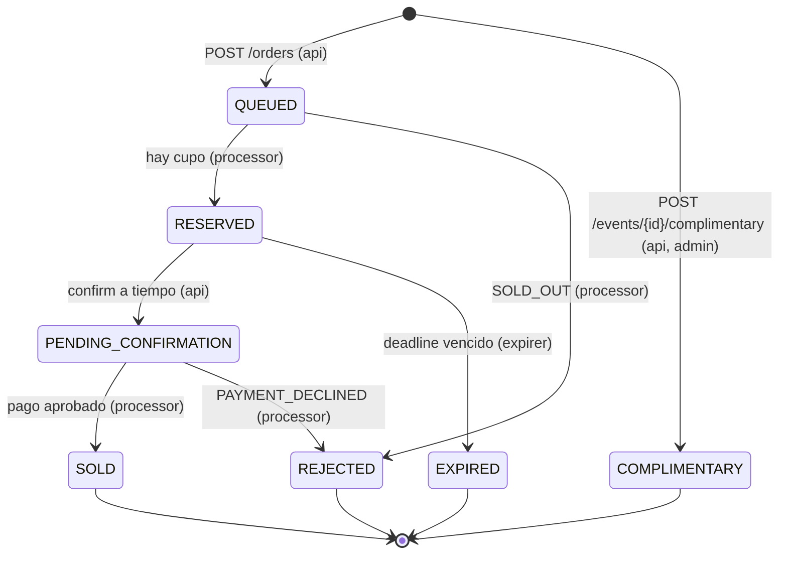

# Modelo de dominio

## 1. Conceptos

| Concepto | Descripción |
|---|---|
| **Event** | Un evento (concierto, teatro, deporte) con nombre, fecha, lugar y capacidad total. Contiene el **inventario**. |
| **Inventory** | Cantidad de entradas del evento en cada estado de entrada. Se modela como contadores, no como una fila por entrada (no hay selección de asiento en los requisitos). |
| **Order** | Una solicitud de compra de N entradas de un evento por un usuario. Tiene un **estado de orden**. |
| **OrderTransition** | Registro inmutable de un cambio de estado de una orden (auditoría). |

## 2. Estados de la entrada (inventario)

Los 5 estados del enunciado. Cada entrada está en **exactamente uno** a la vez; por eso se modelan como
contadores cuya suma es invariante:

```
available + reserved + pendingConfirmation + sold + complimentary == capacity
```

| Estado de entrada | Contador | ¿Es venta? | Final |
|---|---|---|---|
| AVAILABLE | `available` | No | No |
| RESERVED | `reserved` | No | No |
| PENDING_CONFIRMATION | `pendingConfirmation` | No | No |
| SOLD | `sold` | **Sí** (contable) | **Sí, irreversible** |
| COMPLIMENTARY | `complimentary` | No (no contable) | **Sí** |

## 3. Estados de la orden



| Estado de orden | Significado | Final | `deadlineAt` |
|---|---|---|---|
| `QUEUED` | Aceptada y encolada; aún no se valida el inventario | No | `createdAt + 5 min` (reconciliación) |
| `RESERVED` | Entradas apartadas; el usuario tiene 10 min para confirmar | No | `reservedAt + 10 min` (expiración) |
| `PENDING_CONFIRMATION` | Pago enviado; esperando validación | No | `confirmedAt + 5 min` (reconciliación) |
| `SOLD` | Pago aprobado | **Sí** | — (se elimina) |
| `COMPLIMENTARY` | Cortesía emitida por un admin | **Sí** | — |
| `REJECTED` | Rechazada; `reason` ∈ {`SOLD_OUT`, `PAYMENT_DECLINED`} | **Sí** | — (se elimina) |
| `EXPIRED` | No se confirmó en 10 min | **Sí** | — (se elimina) |

`deadlineAt` es "la hora límite del estado actual". Solo existe en estados no finales; por eso el GSI
`status-deadlineAt-index` es **disperso**: solo contiene órdenes que el expirer debe revisar.

## 4. Transiciones (fuente de verdad)

Cada fila es **una** transacción DynamoDB (`TransactWriteItems`) que escribe orden + evento + auditoría.
Si cualquier condición falla, no se escribe nada.

| # | Transición de orden | Movimiento de inventario | Ejecuta | Condición (además de la de estado) |
|---|---|---|---|---|
| T1 | — → `QUEUED` | — | api | `attribute_not_exists(orderId)` |
| T2 | `QUEUED → RESERVED` | available → reserved | processor | `available >= qty` |
| T3 | `QUEUED → REJECTED (SOLD_OUT)` | — | processor | se ejecuta cuando T2 falla por inventario |
| T4 | `RESERVED → PENDING_CONFIRMATION` | reserved → pendingConfirmation | api | `deadlineAt > now` y `userId = caller` |
| T5 | `PENDING_CONFIRMATION → SOLD` | pendingConfirmation → sold | processor | pago aprobado |
| T6 | `PENDING_CONFIRMATION → REJECTED (PAYMENT_DECLINED)` | pendingConfirmation → available | processor | pago rechazado |
| T7 | `RESERVED → EXPIRED` | reserved → available | expirer | `deadlineAt < now` |
| T8 | — → `COMPLIMENTARY` | available → complimentary | api (admin) | `available >= qty` |

**Regla general:** toda transición exige `status = <estado origen>`. Esa condición vuelve idempotente
a cada consumidor (un mensaje repetido no puede aplicar la misma transición dos veces) y resuelve las
carreras (p. ej. T4 contra T7: solo una de las dos encuentra la orden en `RESERVED`).

Además de las transiciones, el expirer hace **reconciliación** (no cambia el estado):

| # | Situación | Acción del expirer |
|---|---|---|
| R1 | `QUEUED` con `deadlineAt < now` (el mensaje a SQS no llegó a publicarse) | Re-publica en `orders-queue` y mueve `deadlineAt` +5 min (condición `status = QUEUED`) |
| R2 | `PENDING_CONFIRMATION` con `deadlineAt < now` | Re-publica en `confirmations-queue` y mueve `deadlineAt` +5 min |

Ver [ADR-0005](../adr/0005-reservation-expiry-and-reconciliation.md).

## 5. Invariantes del dominio

1. La suma de contadores del evento siempre es igual a `capacity`; ningún contador es negativo.
2. Una orden tiene exactamente un estado; los estados finales no cambian nunca.
3. `SOLD` solo se alcanza desde `PENDING_CONFIRMATION`, y esta solo desde `RESERVED` antes de su `deadlineAt`.
4. Toda transición deja exactamente una fila en la auditoría, en la misma transacción.
5. Una misma `(userId, Idempotency-Key)` produce siempre la misma orden.

## 6. Representación en Java (guía)

```java
// Immutable: every transition returns a new instance.
public record Order(OrderId id, EventId eventId, UserId userId, int quantity,
                    OrderStatus status, RejectionReason reason, Instant deadlineAt,
                    String requestHash, Instant createdAt, Instant updatedAt) {

    public Order reserve(Instant now, Duration ttl) {
        return switch (status) {
            case QUEUED -> withStatus(OrderStatus.RESERVED, now).withDeadline(now.plus(ttl));
            default -> throw new InvalidOrderStateException(id, status, OrderStatus.RESERVED);
        };
    }
}

public enum OrderStatus {
    QUEUED, RESERVED, PENDING_CONFIRMATION, SOLD, COMPLIMENTARY, REJECTED, EXPIRED;

    public boolean isFinal() {
        return switch (this) {
            case SOLD, COMPLIMENTARY, REJECTED, EXPIRED -> true;
            case QUEUED, RESERVED, PENDING_CONFIRMATION -> false;
        };
    }
}

public record Inventory(int capacity, int available, int reserved, int pendingConfirmation,
                        int sold, int complimentary) {
    public Inventory { /* validates invariant: sum == capacity, no counter < 0 */ }
}
```

El dominio valida las reglas en memoria (fail fast); DynamoDB las **garantiza** con las condiciones de
la transacción, que son la fuente de verdad bajo concurrencia.
