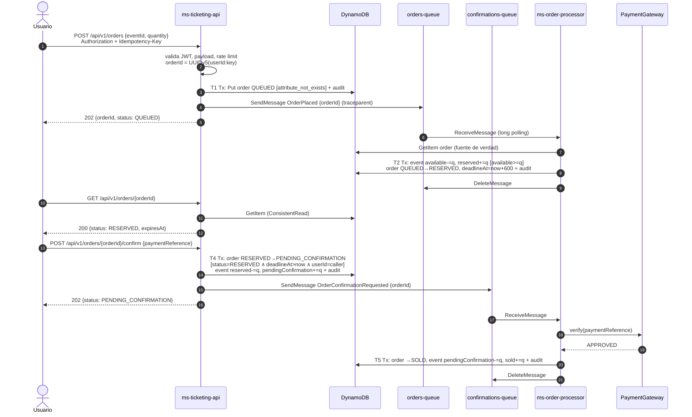
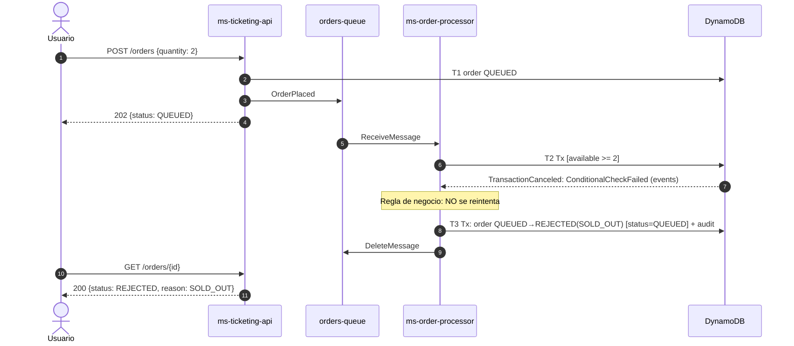
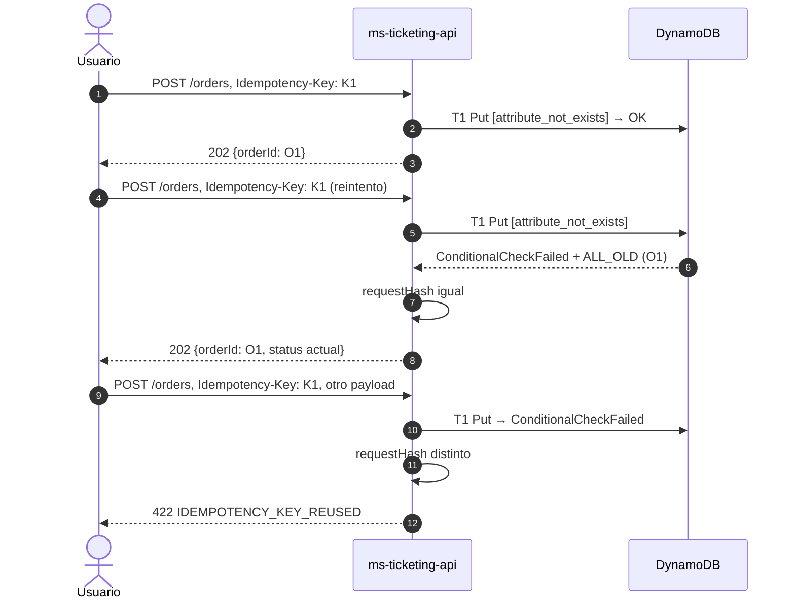
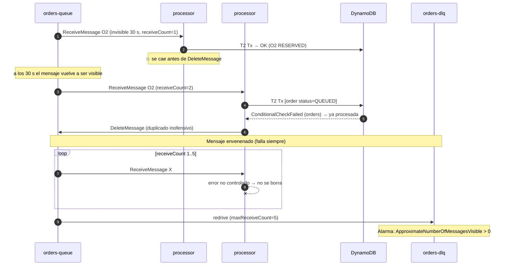
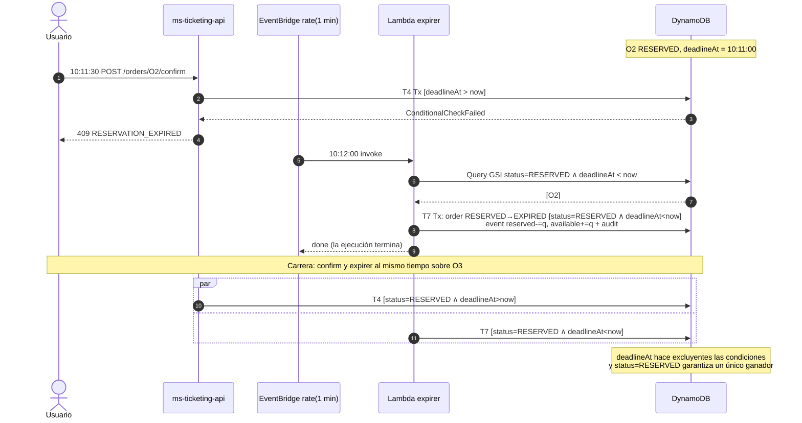
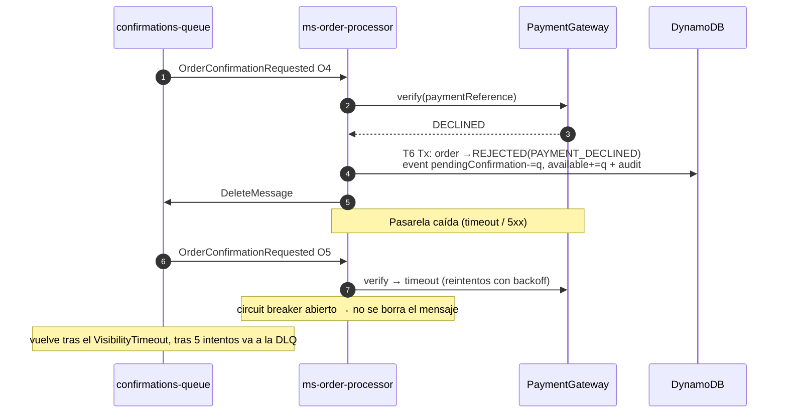
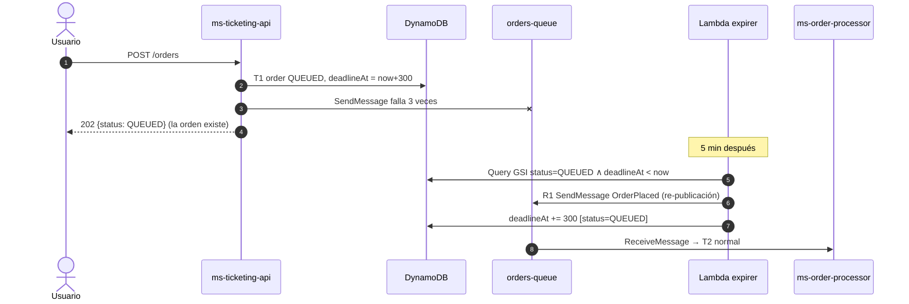
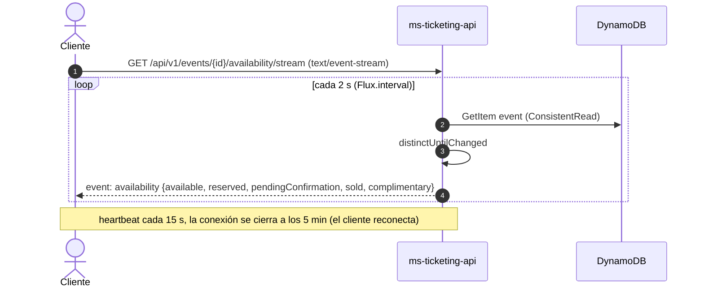

# Diagramas de secuencia

Notación: `Tn` y `Rn` son las transiciones y reconciliaciones del [modelo de dominio](../design/domain-model.md).

## 1. Compra exitosa (camino feliz)

## 2. Sin cupo (sobreventa evitada)

## 3. Reintento del cliente (idempotencia)

## 4. Caída del processor, mensaje duplicado y DLQ

## 5. Expiración y carrera con la confirmación

## 6. Pago rechazado

## 7. Reconciliación del dual write (DynamoDB OK, SQS falló)

## 8. Disponibilidad en tiempo real (SSE)

